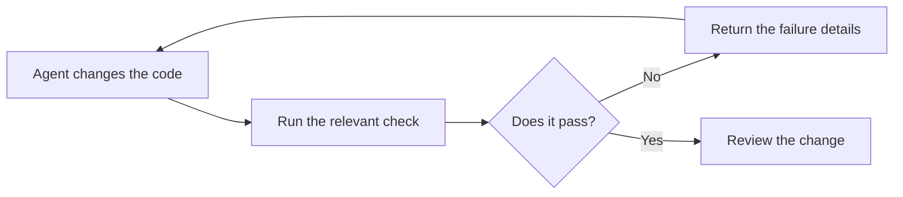

When working with coding agents, your first instinct might be to put your project's rules or the steps of a workflow or etc into your `AGENTS.md`, a skill or another instruction file. If something goes wrong, it feels quite tempting to change the wording or add even more details.

I recently went through the skill and instruction files for an iOS project to see which parts of it can be automated. One package's instruction basically said something like:

> Files in the domain layer must not import SwiftUI or UIKit.

Here, both the domain and UI related files belong to the same iOS target, which means those frameworks are available to them and the compiler will happily accept the imports.

So I turned that restriction into a lint rule and when I ran it, it actually flagged a domain file which imported UIKit.

I ended up turning a bunch of other requirements into checks too, testing them against some examples that should pass and fail, much like an eval.

It's important to keep the check's commands in those instructions because it helps the agent run them during a task. You can also run it automatically through a hook or a CI job and then make it a requirement for merging code. Providing a helpful failure report also provides valuable context to an agent to correct the problem and re-run the check.



## Choosing a tool

You can use a tool like [SwiftLint](https://github.com/realm/SwiftLint#defining-custom-rules) to express the import check as a custom rule that is scoped to those domain files. I would also check which other existing tools exist on your development environment before adding another tool to your workflow. Other requirements could have familiar checks too:

| The requirement                                          | What could check it                                                                           |
| -------------------------------------------------------- | --------------------------------------------------------------------------------------------- |
| You want to follow the project's code style guide        | A formatter and/or linter                                                                     |
| You want to enforce module boundaries                    | An architectural linter or build rules                                                        |
| You want to ensure the code compiles                     | A type checker or compiler                                                                    |
| You want to preserve a specific program behaviour.       | A test (E2E/unit/snapshot)                                                                    |
| You want to ensure commit messages follow a given format | A commit message linter or a script                                                           |
| You want to keep sensitive data out of logs.             | A linter, test or static analysis tool                                                        |

A rule can also restrict references between files in the same module. Let's say an app has this rule:

> Each feature is only allowed to use its own files and code from a Shared module

A feature like `Search` or `Profile` can both use `Shared`, however a call from `Search` to a function inside `Profile` would be a violation.

 ```mermaid
 flowchart LR
     Search["Search feature"] -->|Allowed| Shared["Shared code"]
     Profile["Profile feature"] -->|Allowed| Shared
     Search -.->|Forbidden| Profile
 ```

Putting `Search` and `Profile` in separate folders or separate modules doesn't necessarily prevent code in one from calling the other, so you need a tool that can follow these references across files.

For my own needs, I actually ended up building my own architectural linter called [Bylaws](https://github.com/theblixguy/swift-bylaws) as I was unhappy with existing tools. Using it, the above rule looks something like this:

```swift
import Bylaws
import BylawsIndex

let app = Codebase(including: ["Sources/**"])

Rule("feature-boundaries", "Features use their own code and Shared") {
  try await app.checkDependencies(
    from: ["Sources/Features/**"],
    allowingReferencesTo: ["Sources/Shared/**"],
    allowingWithinFoldersMatching: "Sources/Features/*",
    modules: ["App"]
  )
}
```

## Automating a repeatable task

I made a similar choice for creating release bundles for my library. In order to prepare a release, I need to copy the executables in to the bundle's output structure and write its package information and etc. Every release has the same steps, so I put them into a [packaging script in swift-bylaws](https://github.com/theblixguy/swift-bylaws/blob/631edf74cadb761082d272795e85b2d02bd623ad/Scripts/make-plugin-artifact-bundle.swift) which takes a version and a list of executables to package.

A skill can then explain when the script should be run and what to do with its result.

You should look for and use an existing tool if it can do the work, but if not then go ahead and build your own - a small Python or Bash script might be sufficient.

## Where I keep written guidance

I couldn't automate all of the instructions - the checks only covered a part of it, so I kept the explanation and the pieces which needed review alongside the rule.

For example, an instruction to keep each file focused on a single responsibility needs that type of judgement. A linter can calculate the number of lines of code or whatever, but whether it should split the file into smaller files (or not) depends on what the code does and which parts belong together.

If we turn this instruction into a line limit, the agent might split the file into smaller ones to pass the check and scatter related code across multiple files. So, what I would do is make the guidance more specific, for example:

> Split a file when it contains code that serves different purposes while keeping closely related code together.

The agent has to judge how this applies to the code that it is changing. Once it's done, you (or someone else) can then assess whether the result is easy to follow or if the agent has not applied the guidance correctly.

Another example is our previous module boundary rule - a check can highlight a dependency that violates our rules, but deciding where the code should belong needs your judgement.

You should put these instructions in your `AGENTS.md`, custom instructions or a skill, with links to docs if something needs more explanation. If you're using a skill, you can also include information about the tools that go with those instructions.

I like to separate the various types of instructions like this when deciding what to automate:

| Type of instruction | An example                                                                                        | How to handle it                                                |
| ------------------- | ------------------------------------------------------------------------------------------------- | --------------------------------------------------------------- |
| Context.            | Older versions of your app still depends on a service that you're working on replacing            | Keep the explanation in an instruction file                     |
| Judgement           | Deciding whether related code should stay in one file or split into smaller ones                  | Provide the criteria for it and then review the proposed design |
| Procedure           | Packaging a library or tool for release                                                           | Use a script or tool for the repeatable steps                   |
| Invariant           | Each feature in your app is only allowed to use its own files and the ones from the Shared module | Check references between feature folders                        |

Sometimes these categories can overlap:

- An architectural rule could need some extra docs to explain why parts of the code should stay separate, plus a check to flag dependencies that should not be allowed.
- A workflow could use a script to combine steps while still containing guidance about what to do with its results.

## Trying this in your own project

You should look through all your instructions or skill files to check if there's work which could be automated by a program. If there are any recurring corrections in your own work or during code reviews they are also a good starting point.

When you have the tool or check in place, try using it for a few tasks to evaluate whether it continues to be helpful or if its creating false positives or unnecessary work. Make sure to update or remove guidance as your tool handles more of the work so your agent has the most relevant context.

Something that I often like to do is simply ask my agent:

> Review our instruction and skill files for rules we could check automatically and repeated steps we could automate. Show me the instructions that you think we could automate and look for tools (online e.g. on GitHub or locally) that we could use to achieve it. If nothing suitable exists, figure out if we could write a reusable script or tool. For each option, explain to me what it could do and which decisions need my judgement and provide recommendations on which options to start with.
