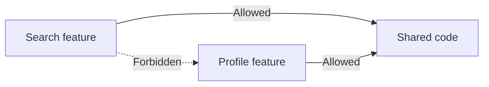
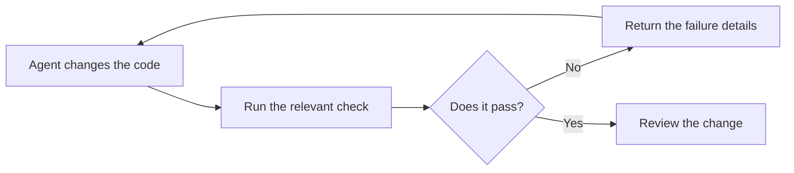

When working with a coding agent, you might want it to follow your project conventions or a workflow to prepare a release or investigate a failed build. In order to do so, your first instinct might be to put your guidance in your `AGENTS.md`, a skill or another instruction file so that the agent can use it across various tasks.

Later, you might run into some recurring problems in your own code or someone else's (e.g. during code review) and you might decide to fine tune that guidance by changing the wording or making things more explicit.

Now as tempting as it seems to keep refining those files, it's worth taking a step back and asking whether the agent can turn some of those instructions into automated checks or reusable tools and scripts.

## What is the instruction asking for?

| Type of instruction | An example                                                                                | How to handle it                                                          |
| ------------------- | ----------------------------------------------------------------------------------------- | ------------------------------------------------------------------------- |
| Project context     | Older versions of your app still depend on a service that you're replacing                | Keep the explanation in written guidance or linked documentation          |
| Judgement           | Deciding whether related code should stay in one file or split into smaller ones          | Provide the criteria and review the proposed design                       |
| Procedure           | Packaging a collection of files for release                                               | Use a script or tool for the repeatable steps and document when to use it |
| Invariant           | Each feature in your app is only allowed to use its own files and ones in a Shared module | Check references between feature folders                                  |

Sometimes these categories can overlap:

- An architectural rule could need some extra docs to explain why parts of the code should stay separate, plus a check to flag dependencies that should not be allowed.
- A workflow could combine scripted steps while still containing guidance about what to do with its results.

## Turn an instruction into an automated check

Let's take this instruction from the above table:

> Within the app, each feature can use only its own files and files in Shared.

A feature like `Search` or `Profile` can both use `Shared`, however a call from `Search` to a function inside `Profile` would be a violation.



Putting `Search` and `Profile` in separate folders or separate modules doesn't necessarily prevent code in one from calling the other, but a lint rule can catch that dependency.

For my own needs, I actually ended up building my own architectural linter called [Bylaws](https://github.com/theblixguy/swift-bylaws) as I was unhappy with existing tools. Using it, the above rule looks something like this:

```swift
import Bylaws
import BylawsIndex

let app = Codebase(including: ["Sources/**"])

Rule("feature-boundaries", "Features use their own code and Shared") {
  try await app.checkDependencies(
    from: ["Sources/Features/**"],
    allowingReferencesTo: ["Sources/Shared/**"],
    allowingWithinFoldersMatching: "Sources/Features/*",
    modules: ["App"]
  )
}
```

Other instructions will need different kinds of checks:

| The requirement                                          | What could check it                                                                           |
| -------------------------------------------------------- | --------------------------------------------------------------------------------------------- |
| You want to follow the project's code style guide        | A formatter and/or linter                                                                     |
| You want to enforce module boundaries                    | An architectural linter or build rules                                                        |
| You want to ensure the code compiles                     | A type checker or compiler                                                                    |
| You want to preserve a specific program behaviour.       | A test (E2E/unit/snapshot)                                                                    |
| You want to ensure commit messages follow a given format | A commit message linter or a script                                                           |
| You want to keep sensitive data out of logs.             | A linter, test or static analysis tool                                                        |

You should use the simplest tool that can reliably check a rule.

## Let a tool automate repeatable work

If your instructions explain how a task should work, for example building the project or running tasks or etc, then you might be able to automate some or all of those steps using a tool or script.

For example, the [packaging script in swift-bylaws](https://github.com/theblixguy/swift-bylaws/blob/631edf74cadb761082d272795e85b2d02bd623ad/Scripts/make-plugin-artifact-bundle.swift) takes a version and a list of executables to package. It then arranges the files and writes the package information to create a bundle for distribution. The inputs change with each new release, but the preparation steps stay the same. So instead of writing out all the steps in a skill, I ended up creating that script.

You should look for and use an existing tool if it can do the work, but if not then go ahead and build your own - a short Python or Bash script might be sufficient. You can provide written guidance which explains how/when to run the tool and what to do with the results.

## Use instructions to guide decisions

Let's say that the agent is working on a large file and your instructions mention that it should keep each file focused on a single responsibility. A linter can calculate the number of lines of code or whatever, but whether it should split the file into smaller files (or not) depends on what the code does and which parts belong together.

If we turn this instruction into a line limit, the agent might split the file into smaller ones to pass the check and scatter related code across multiple files.

So what you should do is make the guidance more specific, for example:

> Split a file when it contains code that serves different purposes while keeping closely related code together.

The agent has to judge how this applies to the code that it is changing. Once it's done, you (or someone else) can then review the code and assess whether the result is easy to follow or if the agent has not applied the guidance correctly.

You should keep this type of guidance in your `AGENTS.md`, custom instructions or a skill, with links to docs if something needs more explanation. If you're using a skill, you can also include information about the tools that go with those instructions.

## Use the commands in the workflow

An instruction to run the check can be easily missed, so it's important to run it automatically through a hook or as part of your CI workflow, with a requirement for the check to pass before changes can be merged.

If a check fails, the report should explain the problem with relevant information so the agent can correct it and run the check again.



A reviewer can assess whether the code belongs in `Search`, `Profile` or `Shared`, even if its dependencies follow our rule.

## Review existing instructions

You should look through all your instructions or skill files to check if there are rules which you want to check or steps that repeat across tasks. If there are any recurring corrections in your own work or during code reviews they are also a good starting point. When doing this, it is important to differentiate between parts that need judgement from the parts that a program can automate for you.

When you have the tool or check in place, do some tests with scenarios that should pass and fail, similar to an eval.

It's also worth revisiting your tools after using it for a few tasks to see whether it continues to be helpful or if its creating unnecessary work, because you will have a better idea for what continues to work and what might need some tweaking. Make sure to update or remove guidance as the code and process change.

Something that I often like to do is simply ask my agent:

> Review our instruction and skill files for rules we could check automatically and repeated steps we could automate. Show me the instructions that you think we could automate and look for tools (online e.g. on GitHub or locally) that we could use to achieve it. If nothing suitable exists, figure out if we could write a reusable script or tool. For each option, explain to me what it could do and which decisions need my judgement and provide recommendations on which options to start with.
